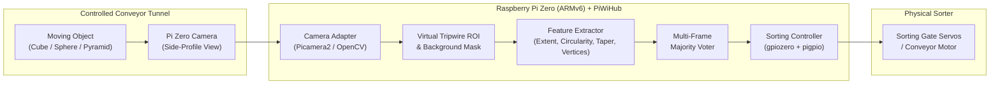

# Destination Imagination: Conveyor Belt Shape Sorter Project Plan

## 1. Executive Summary & System Overview

This project builds an automated computer-vision shape detection and sorting system for a **Destination Imagination (DI)** sorting machine. Objects (initially **Cubes**, **Spheres**, and **Pyramids**) move along a conveyor belt past a fixed **Raspberry Pi Zero Camera**, are classified in real time by a **Raspberry Pi Zero** (equipped with a **PiWiHub** for USB and Wi-Fi connectivity), and are physically routed into bins by Pi-controlled sorting actuators.

To support rapid development and flexibility when rules or props change, the software is architected to **run and test on macOS first** (using a Mac webcam, video files, or test images) and deploy unmodified to the **Raspberry Pi Zero**.



---

## 2. Key Architectural Recommendations

### 2.1 Camera Placement: Side-Profile View (Crucial for 3D Shapes)

> [!IMPORTANT]
> **Why Side-Profile Beats Top-Down for Cubes, Spheres, and Pyramids:**
> From directly above (top-down), both a **Cube** and a **Square Pyramid** have a square silhouette, making them difficult to tell apart without fragile shading analysis.
> Viewed from the **side** (level with the belt, or slightly angled at 10°–15° looking against a flat background wall), the three shapes have unmistakable 2D silhouettes regardless of how they are rotated on the belt:
> - **Sphere:** Circular silhouette from every angle (high circularity, curved top and sides).
> - **Cube:** Rectangular silhouette from every rotation (flat horizontal top edge, vertical sides, fills >80% of its bounding box).
> - **Pyramid:** Triangular silhouette from every rotation (tapers to a single pointed apex at the top, fills ~50% of its bounding box).

* **Controlled Lighting Tunnel:** Build a small 3-sided cardboard or foam-core "inspection tunnel" over the camera zone with a matte black (or high-contrast) background wall behind the belt and a diffused white LED strip inside. This blocks gym/competition hall lighting variations and guarantees clean thresholding.

### 2.2 Conveyor Motion & Triggering: Continuous Slow Belt + Software "Virtual Tripwire"

We recommend starting with **Continuous Motion + a Software Inspection Zone (Virtual Tripwire)**, with software support to add a physical sensor or belt-pause later if needed:

1. **How it works:** The camera streams low-resolution frames (`320x240` at ~15–20 FPS). The software monitors a narrow vertical band in the center of the frame (the **Inspection Zone**).
2. **Object Tracking & Multi-Frame Voting:**
   - When an object's contour enters the central zone and is **not touching the left or right borders** of the image, the Pi classifies the shape across **3 to 5 consecutive frames**.
   - Once the object leaves the zone, the Pi takes the **majority vote** (e.g., 4 frames say `PYRAMID`, 1 says `CUBE` $\rightarrow$ result is `PYRAMID`) and triggers the sorting gate after a configurable travel delay.
3. **Why this is ideal for DI:**
   - Zero extra sensor wiring required to get started.
   - Multi-frame voting eliminates single-frame motion blur or rotation glitches.
   - If your team later decides to pause the belt or add a \$2 IR break-beam sensor, the software architecture allows swapping the trigger mode in configuration.

### 2.3 Respecting Original Raspberry Pi Zero (ARMv6) Constraints

> [!WARNING]
> The original Raspberry Pi Zero uses a **32-bit ARMv6 single-core CPU** with **512 MB RAM**. Many standard `pip` packages (like `opencv-python` or `tflite-runtime` on PyPI) are compiled for ARMv7/ARMv8 and will crash with `Illegal instruction` on an original Pi Zero.

To keep performance fast (30–50 ms per frame) and installation reliable:
* **OS:** Run **Raspberry Pi OS Lite (32-bit)** (headless, no desktop GUI) to save ~200 MB of RAM and CPU cycles.
* **System Packages (`apt` over `pip`):** Install OpenCV, Picamera2, and NumPy via Raspberry Pi's official `apt` repositories (`python3-opencv`, `python3-picamera2`, `python3-numpy`), which are specifically pre-compiled for ARMv6.
* **Hardware PWM for Servos:** Because a single-core CPU under image-processing load will cause software PWM servos to twitch, we will use `gpiozero` backed by the `pigpio` daemon (`PiGPIOFactory`), which uses hardware DMA timing for rock-solid servo control.
* **Power Isolation:** Never power sorting servos or conveyor motors from the Pi Zero's 5V pin. Use a separate 5V/6V battery pack for motors/servos with a **common Ground (`GND`)** connected to the Pi Zero.

---

## 3. Flexible Shape Classification Design

Because your team may change or add shapes later, we will avoid brittle hard-coded pixel rules and instead use a **two-part Feature + Calibration pipeline**:

### 3.1 Scale-Invariant Geometric Feature Extraction
For each detected object contour, the pipeline extracts a small vector of normalized geometric features (which remain constant even if the object size changes slightly):

| Feature | Formula / Meaning | Cube | Sphere | Pyramid |
| :--- | :--- | :---: | :---: | :---: |
| **Extent** | $\text{Contour Area} / \text{Bounding Box Area}$ | High ($0.80 - 0.98$) | Medium ($0.72 - 0.80$) | Low ($0.45 - 0.62$) |
| **Taper Ratio** | $\text{Width at top 25\%} / \text{Width at bottom 75\%}$ | $\approx 0.90 - 1.05$ | $\approx 0.70 - 0.85$ | **Low ($0.20 - 0.50$)** |
| **Circularity** | $4\pi \times \text{Area} / \text{Perimeter}^2$ | Medium ($0.65 - 0.78$) | **High ($0.83 - 0.98$)** | Low ($0.50 - 0.68$) |
| **Solidity** | $\text{Contour Area} / \text{Convex Hull Area}$ | High ($> 0.93$) | High ($> 0.95$) | High ($> 0.92$) |
| **Polygon Vertices** | `cv2.approxPolyDP` corner count | $4$ | $\ge 6$ | $3$ |

### 3.2 Two Ways to Add or Change Shapes Later
1. **Rule/Threshold Config (`config/shapes.yaml`):** Quick human-readable ranges for simple geometric shapes.
2. **Sample-Based Auto-Calibration (Nearest-Centroid / Lightweight Classifier):**
   - Put 15–30 sample snapshots of any new object into `data/samples/<shape_name>/`.
   - Run `python -m sorter.calibrate`, which computes the feature centroids/covariance for each folder and saves a lightweight `shapes_model.json` file (using only `numpy`, zero heavy ML libraries needed).
   - If you switch from Pyramids to Cylinders, Stars, or L-blocks later, you just capture 20 frames on the belt and re-run calibration!

---

## 4. Software Architecture (Mac-First, Pi-Ready)

```text
destination_imagination/
├── README.md
├── PROJECT_PLAN.md
├── requirements-mac.txt         # opencv-python, numpy, pyyaml, pytest (for macOS dev)
├── setup_pi.sh                  # apt install script for Raspberry Pi Zero (ARMv6)
├── config/
│   ├── settings.yaml            # ROI coordinates, camera resolution, GPIO pins, delays
│   └── shapes_model.json        # Calibrated shape feature definitions
├── data/
│   └── samples/                 # Training/test images organized by shape name
│       ├── cube/
│       ├── sphere/
│       └── pyramid/
├── src/
│   └── sorter/
│       ├── __init__.py
│       ├── main.py              # Entry point (--mode live | calibrate | collect | replay)
│       ├── camera.py            # Abstract Camera: MacWebcam, ImageFolder, PiCamera2
│       ├── preprocessor.py      # ROI crop, background subtraction / thresholding
│       ├── features.py          # Extracts extent, taper ratio, circularity, vertices
│       ├── classifier.py        # Rule-based + calibrated nearest-centroid classifier
│       ├── tracker.py           # Virtual tripwire detection & multi-frame majority vote
│       ├── actuator.py          # Abstract Actuator: MockDisplayActuator (Mac) vs GPIOActuator (Pi)
│       └── visualizer.py        # Debug overlay (bounding box, features, FPS, vote status)
└── tests/
    ├── test_features.py         # Unit tests using synthetic & real shape images
    └── test_classifier.py       # Accuracy tests across cube, sphere, pyramid datasets
```

---

## 5. Phased Implementation Roadmap

### Phase 1: Core Vision & Synthetic Testing on macOS (Immediate Start)
* **Goal:** Build and verify the complete detection, feature extraction, and classification pipeline on your Mac before touching hardware.
* **Tasks:**
  1. Set up Python virtual environment on macOS (`requirements-mac.txt`).
  2. Create a synthetic dataset generator (`scripts/generate_test_shapes.py`) and webcam capture tool so you can test immediately with synthetic shapes or household objects held in front of your Mac camera.
  3. Implement `preprocessor.py`, `features.py`, `classifier.py`, and `visualizer.py` with a live debug window showing the Inspection Zone, contour outline, live feature numbers, and classification result.
  4. Write automated unit tests (`pytest`) verifying >95% accuracy on rotated cubes, spheres, and pyramids.

### Phase 2: Raspberry Pi Zero + PiWiHub + Camera Bring-Up
* **Goal:** Get the Pi Zero capturing frames over the Pi Zero Camera and streaming/logging results over Wi-Fi.
* **Tasks:**
  1. Flash **Raspberry Pi OS Lite (32-bit)** to microSD with SSH and Wi-Fi configured.
  2. Run `setup_pi.sh` to install `python3-picamera2`, `python3-opencv`, `python3-numpy`, `python3-gpiozero`, and `pigpiod`.
  3. Verify camera capture with `rpicam-still` / `picamera2` and benchmark frame processing speed on the Pi Zero at `320x240` resolution (target: 15+ FPS).
  4. Add a lightweight MJPEG web debug stream or frame snapshot saver so the team can see what the Pi Zero camera sees from a laptop browser over Wi-Fi.

### Phase 3: Conveyor Tunnel & Calibration
* **Goal:** Mount the camera to the conveyor belt, control lighting, and calibrate with real DI props.
* **Tasks:**
  1. Construct the side-profile camera mount and high-contrast backdrop/lighting tunnel.
  2. Run the Pi Zero in **Data Collection Mode** (`python -m sorter.main --mode collect`) while running Cubes, Spheres, and Pyramids down the belt to automatically save cropped snapshots.
  3. Run the calibration script to lock in the feature thresholds/centroids for your actual physical objects.

### Phase 4: Motor & Servo Actuation Integration
* **Goal:** Connect the Pi Zero GPIO pins to the sorting mechanism and tune timing.
* **Tasks:**
  1. Wire sorting servos (or motor driver such as L298N/TB6612FNG) to the Pi Zero GPIO header and an external 5V/6V battery pack (shared `GND`).
  2. Implement `GPIOActuator` in `actuator.py` with configurable **travel delay** (time between camera classification and the object reaching the diverter gate).
  3. End-to-end sorting trials on the moving conveyor belt and failure-mode hardening (e.g., handling two objects placed too close together or an unrecognized object).

---

## 6. Hardware & Wiring Checklist

| Component | Recommendation / Notes |
| :--- | :--- |
| **Compute** | Raspberry Pi Zero (v1.3) + **PiWiHub** attachment (USB + Wi-Fi) |
| **Camera** | Raspberry Pi Zero Camera (connected via the narrow 22-pin Pi Zero CSI ribbon cable) |
| **MicroSD Card** | 16 GB+ Class 10 / A1 microSD with Raspberry Pi OS Lite (32-bit) |
| **Camera Mount** | Side-profile view perpendicular to belt travel, 15–25 cm from belt center |
| **Lighting & Backdrop** | Matte black (or solid contrasting color) background wall behind belt + fixed white LED strip |
| **Sorting Actuators** | Micro/Standard Servos (e.g., SG90 / MG996R) for diverter gates, driven via `pigpio` hardware PWM |
| **Actuator Power** | Separate 4xAA (6V) or 5V UBEC battery supply for servos/motors (connect `GND` to Pi Pin 6/9/14) |

