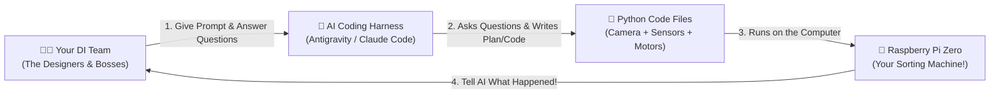
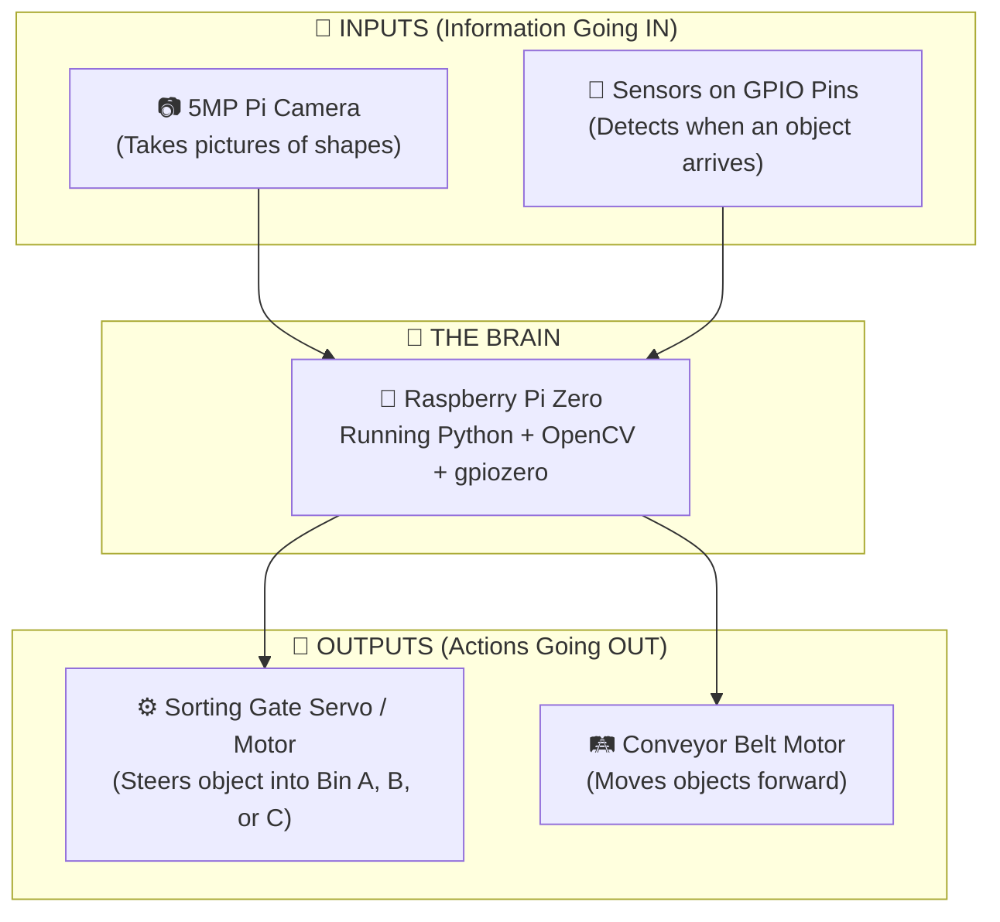
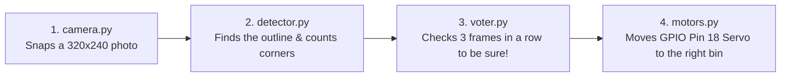

# 🤖 Mission Briefing: Building Our Sorting Machine Brain with AI!
**A 4th-Grade Team Guide to Coding a Raspberry Pi Zero with Antigravity or Claude Code**

Welcome, Engineers! 🚀

You are building an awesome **Sorting Machine** for **Destination Imagination**. Your machine has a conveyor belt, sensors, motors, a **5MP Raspberry Pi Camera**, and a tiny computer called a **Raspberry Pi Zero**.

To make your machine smart enough to recognize shapes and sort them into the right bins, it needs **software** (computer code written in a language called **Python**).

The coolest part? You don't have to memorize a giant book of computer code! You are going to use an **AI Software Engineering Harness** (like **Antigravity** or **Claude Code**).

---

## 🧠 Wait... What is an "AI Software Engineering Harness"?

Imagine you are the **Chief Architect** building a giant LEGO castle, and you have a super-fast robot helper sitting next to you.
* **You and your team are the Bosses (The Designers):** You decide what the sorting machine looks like, what shapes it sorts, where the sensors go, and how the motors push the objects.
* **The AI is your Builder:** When you explain your machine clearly, the AI writes the Python code, organizes your files, and helps you test and fix mistakes!



> [!TIP]
> **The Golden Rule of AI Coding:** Never ask the AI to *"Write all the code right now!"* in your first message. Real engineers **plan first**, then **build one small piece at a time**, and **test each piece**!

---

## 📺 Watch First: Helpful YouTube Videos for Your Team

Before you start, watch these short videos together so everyone knows how folders, files, and Raspberry Pi pins work:

1. **📁 How to Create Folders and Organize Files on a Computer:**
   * 🎥 [Watch: Understanding Files and Folders for Kids (YouTube)](https://www.youtube.com/results?search_query=files+and+folders+on+a+computer+for+kids+tutorial)
   * 🎥 [Watch: Beginner Terminal Commands (`mkdir`, `cd`) Explained Simply (YouTube)](https://www.youtube.com/results?search_query=terminal+basics+mkdir+cd+for+beginners)
2. **🍓 What is a Raspberry Pi & How Do GPIO Pins Work?**
   * 🎥 [Watch: Raspberry Pi GPIO Pins Explained for Beginners (YouTube)](https://www.youtube.com/results?search_query=raspberry+pi+gpio+pins+explained+for+beginners+kids)
   * 🎥 [Watch: Controlling Motors, Servos, and Sensors with Python `gpiozero` (YouTube)](https://www.youtube.com/results?search_query=raspberry+pi+gpiozero+servo+motor+sensor+tutorial)
3. **📷 How to Connect the 5MP Raspberry Pi Camera Ribbon Cable:**
   * 🎥 [Watch: How to Connect a Camera to a Raspberry Pi Zero (YouTube)](https://www.youtube.com/results?search_query=how+to+connect+camera+to+raspberry+pi+zero+tutorial)
4. **🗂️ How Programmers Manage Code Projects:**
   * 🎥 [Watch: How to Organize a Coding Project Folder for Beginners (YouTube)](https://www.youtube.com/results?search_query=how+to+organize+python+project+folders+for+beginners)

---

## 🛠️ Meet Your Sorting Machine's Body Parts

To talk to your AI helper, it helps to know the four main parts of your robot:



* **Inputs** are how the Raspberry Pi senses the world (the **5MP Camera** and **Sensors** like a beam-break light sensor, button, or ultrasonic distance sensor).
* **The Brain** is your **Raspberry Pi Zero** running **Python** code. It uses special Python toolboxes (called **libraries**):
  * `picamera2`: Lets Python take pictures with the 5MP camera.
  * `opencv` (`cv2`): Lets Python trace outlines of shapes and count corners!
  * `gpiozero`: Lets Python read sensors and spin motors using the metal pins on the Pi.
* **Outputs** are the muscles that move things (like **Servos** or **DC Motors** connected to the GPIO pins).

---

## 🗺️ The 5 Steps to Build Your Software

Here is the secret recipe real software engineers use. Follow these 5 steps in order!

---

### Step 1: Create Your Project Folder (Your "Workshop")

**Why we do this:** An AI coding tool works inside a **folder** on your computer. Keeping all your plans and Python files in one clean folder stops things from getting lost.

1. Make a new folder on your computer named `sorting_machine`.
2. Open **Antigravity** or **Claude Code** and open that `sorting_machine` folder.

---

### Step 2: The Detective Interview (Creating the Requirements)

**What are "Requirements"?**
Requirements are simply a checklist of **what your machine needs to do**.

**Why we do this first:** If you tell a builder "Build me a house!" without telling them how many bedrooms you want, you might get a doghouse! We want the AI to **ask you questions** about your sorting machine first.

#### 📋 Copy & Paste Prompt #1 (The Requirements Interview)
Copy the box below and paste it into your AI chat:

```text
Hi! We are a team of 4th-grade students building a sorting machine for Destination Imagination.
We are using a Raspberry Pi Zero, a 5MP Raspberry Pi Camera, and the GPIO pins on the Pi Zero to read sensors and control motors/servos using Python.

Please act as our friendly robotics engineering coach!
DO NOT write any Python code yet.
Instead, interview us to help us figure out our project REQUIREMENTS.
Ask us 3 or 4 simple questions at a time about:
1. What objects or shapes we are sorting (and how many sorting bins we have).
2. How our conveyor belt moves and where our camera and sensors are placed (our INPUTS).
3. What kind of motors or servos will push or steer the objects into the bins (our OUTPUTS).
4. How we want to test our code on our laptop before putting it on the Raspberry Pi Zero.

Wait for our answers after each set of questions. Once you have everything you need, create a kid-friendly markdown file called REQUIREMENTS.md that lists our machine's goals, inputs, and outputs.
```

#### 👀 What Your `REQUIREMENTS.md` File Should Look Like
After you answer the AI's questions, the AI will create a file called `REQUIREMENTS.md`. Check that it looks similar to this example:

```markdown
# 📋 Our Sorting Machine Requirements

## 1. What We Are Sorting
* **Shapes:** Cubes, Spheres, and Pyramids (and we might add Cylinders later!).
* **Camera View:** The camera looks at the side of the conveyor belt against a dark cardboard tunnel wall.

## 2. Our Inputs (Sensing)
* **5MP Raspberry Pi Camera:** Plugged into the camera ribbon port to take pictures of each object.
* **Entry Sensor (Optional):** An infrared break-beam sensor on GPIO Pin 17 that tells the Pi when a shape enters the camera zone.

## 3. Our Outputs (Moving)
* **Sorting Gate Servo:** Connected to GPIO Pin 18.
  * Turn Left (-45 degrees) -> Cube Bin
  * Stay Straight (0 degrees) -> Sphere Bin
  * Turn Right (+45 degrees) -> Pyramid Bin
```

---

### Step 3: The Blueprint & Pinout Map (Creating the Architecture)

**What is "Architecture"?**
Architecture is the **blueprint** of your software and wiring. It decides:
1. Which **GPIO pins** on the Raspberry Pi Zero connect to which wires.
2. Which **Python files** will do which jobs (one file for the camera, one for recognizing shapes, one for moving the motors).

> [!CAUTION]
> **⚡ Super Important Safety Rule for Motors & Pins:**
> The Raspberry Pi Zero is a tiny computer, not a heavy battery!
> * **Signal pins** (like `GPIO 17` or `GPIO 18`) send weak whisper signals to tell a motor *when* to turn.
> * **Power wires** for motors and servos must connect to a **separate battery pack** (like 4 AA batteries), with the black **Ground (`GND`)** wire shared between the battery pack and a `GND` pin on the Raspberry Pi. Always have an adult or coach double-check your wires before turning on the power!

#### 📋 Copy & Paste Prompt #2 (The Architecture & Pinout Coach)
Once your `REQUIREMENTS.md` looks great, paste this second prompt into the AI:

```text
Great! Our REQUIREMENTS.md is ready. Now let's design our software ARCHITECTURE and our Raspberry Pi Zero GPIO Pinout Map.

Still DO NOT write the Python code yet.
First, ask us any questions you need about:
1. What specific sensors or motor driver boards we have on our table right now.
2. How long it takes an object to travel from the camera to the sorting gate.

Then, create a file called ARCHITECTURE.md written for 4th graders that includes:
- A Mermaid diagram showing how a picture travels from the 5MP Camera -> Shape Detector -> Motor Controller.
- A GPIO Pinout Table showing exactly which Raspberry Pi Zero pins we should plug our sensor wires, servo signal wires, and Ground (GND) wires into.
- A list of the Python files we will create in our folder and what each file's job is.
- Remember that our Raspberry Pi Zero has an older ARMv6 processor, so pick fast, lightweight Python libraries (like picamera2, opencv, and gpiozero with pigpio) that work well on a Pi Zero!
```

#### 👀 What Your `ARCHITECTURE.md` File Should Look Like
Your AI will create a blueprint with a folder map and a pinout chart like this:



**Example GPIO Pinout Table in `ARCHITECTURE.md`:**

| Part Name | Wire Function | Connect to Raspberry Pi Zero Pin | Why? |
| :--- | :--- | :--- | :--- |
| **5MP Pi Camera** | Ribbon Cable | **CSI Camera Port** (end of board) | Fast video cable directly to the Pi brain |
| **Break-Beam Sensor** | Signal Wire (Yellow/White) | **GPIO 17** (Physical Pin 11) | Tells Python when an object blocks the light beam |
| **Sorting Servo** | Signal Wire (Orange/Yellow) | **GPIO 18** (Physical Pin 12) | Sends the angle command (-45°, 0°, +45°) |
| **Battery Pack & Sensor** | Ground Wire (Black / Brown) | **GND** (Physical Pin 6, 9, or 14) | All parts must share a common Ground (`GND`)! |

And your project folder will look clean and organized like this:

```text
sorting_machine/
├── REQUIREMENTS.md       # Our checklist of what the machine does
├── ARCHITECTURE.md       # Our blueprint and GPIO pinout chart
├── camera.py             # Talks to the 5MP Camera (or laptop webcam)
├── shape_detector.py     # Figures out if a shape is a Cube, Sphere, or Pyramid
├── motors_and_sensors.py # Controls the GPIO pins for servos and sensors
└── main.py               # The main boss program that runs the machine!
```

---

### Step 4: Building the "Eyes" First (Testing on a Laptop!)

**Why we do this before wiring the motors:**
It is much easier to test shape recognition on a laptop screen where you can see a live video window with boxes drawn around your shapes!

#### 📋 Copy & Paste Prompt #3 (Build the Camera & Shape Detector)

```text
Now we are ready to build Step 1 of our code: the Camera and Shape Detector!

Please write the Python code for `camera.py` and `shape_detector.py` so that we can test it on our laptop webcam first (and also run it on the Raspberry Pi Zero 5MP camera later).

Please include:
1. A simulation or webcam test mode that opens a window on our screen.
2. Draws a bright outline around the object and prints whether it sees a CUBE, SPHERE, or PYRAMID on the screen.
3. Easy-to-read comments in the Python code so a 4th grader can see how the computer measures the shape (like counting corners or checking if the top is pointy like a pyramid).
4. Step-by-step instructions showing us the exact command to type in the Terminal to run and test it!
```

#### 👀 What It Looks Like When It Works!
When you run the command the AI gives you, a window will pop up on your screen:
* Hold a **Cube** (or square block) in front of the camera $\rightarrow$ A blue box appears saying **`CUBE (4 corners)`**!
* Hold a **Ball (Sphere)** in front of the camera $\rightarrow$ A green circle appears saying **`SPHERE (Round)`**!
* Hold a **Pyramid** in front of the camera $\rightarrow$ An orange triangle appears saying **`PYRAMID (3 corners / Pointy top)`**!

---

### Step 5: Connecting the Sensors & Motors on the Pi Zero

Once the camera brain works on your laptop, you are ready to build the motor and sensor code for the Raspberry Pi Zero!

#### 📋 Copy & Paste Prompt #4 (Build the Sensor & Motor Code)

```text
Our shape detector works! Now let's build `motors_and_sensors.py` and `main.py` using our GPIO pinout map from ARCHITECTURE.md.

Before you write the code, ask us:
1. If any of our GPIO pin numbers changed while we were wiring the machine.
2. What angles our servo needs to turn to reach each sorting bin.

Also, please write a small test script called `test_hardware.py` that lets us test just the sensor and just the servo motor by themselves (for example: wiggle the servo left, center, and right) so we can make sure our wires are plugged into the right pins before running the full conveyor belt!
```

---

## 🐞 Step 6: How to Talk to the AI When Something Goes Wrong (Debugging!)

Even professional NASA engineers have bugs in their code on the first try! When something doesn't work, **don't panic**—your AI harness is an expert bug-fixer if you give it good clues.

Here is how to report a problem to your AI:

| What Happened | ❌ Bad Prompt (Too Vague) | ✅ Awesome Engineer Prompt (Gives Clues!) |
| :--- | :--- | :--- |
| **An error message appears in the Terminal** | *"It's broken, fix it."* | *"When I ran `python3 main.py`, I got this error message: [copy and paste the error text here]. Can you explain what went wrong and fix it?"* |
| **The camera mixes up two shapes** | *"The camera doesn't work."* | *"When we put a Pyramid on the belt, the screen says CUBE. How can we adjust `shape_detector.py` so it notices the pointy top of the pyramid better?"* |
| **The motor moves too early or too late** | *"The motor missed the block."* | *"The camera sees the Cube correctly, but the sorting gate moves 1 second too early before the Cube reaches the gate. Where can we change the delay timer?"* |
| **You want to add a brand-new shape!** | *"Add a cylinder."* | *"We want to add a 4th shape: a Cylinder! Ask us how our cylinder looks from the camera's side view, and help us update our detector and add a 4th servo position."* |

---

## 🏆 Team Checklist Before Competition Day

- [ ] **Folder Check:** All our code and `.md` plans are saved inside our project folder.
- [ ] **Lighting Check:** Our camera looks inside a shaded tunnel with a plain dark background so gym lights don't confuse it.
- [ ] **Battery Check:** Our motor/servo battery pack has fresh batteries and shares a `GND` wire with the Raspberry Pi Zero.
- [ ] **Hardware Test:** We ran `test_hardware.py` and every servo gate moves smoothly to the right bin.
- [ ] **Team Understanding:** Every teammate can explain to the Destination Imagination Appraisers **what the Inputs are**, **how the Pi Zero detects the shapes**, and **how the Outputs sort them**!
